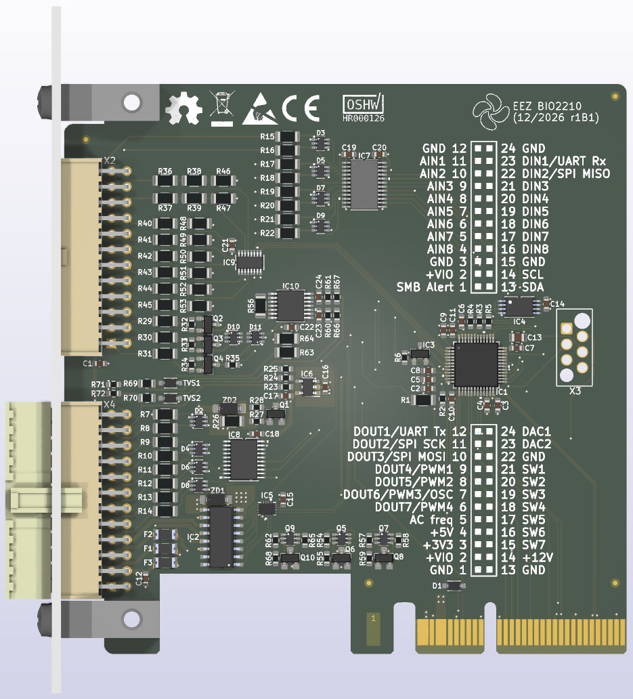

### BB3+ BIO2210 module

Basic **non-isolated** I/O module

* 32-bit MCU, 250 MHz
* 8-ch protected analog inputs (multiplexed): 2 x 0-100 V, 6 x 10 V
* 2-ch protected analog outputs 0-10 V
* 1.8 / 3.3 / 5 V logic level protected 8 digital input (alternative function: SPI and UART)
* 1.8 / 3.3 V logic level protected 7 digital outputs (alternative function: SPI, PWM, programmable clock output) + AC Freq output
* 7 low-side switches
* Protected 1.8 / 3.3 V I2C/SMBus interface
* 3.3V, 5V and 12V fused power outputs with reverse current blocking
* SPI and USB communication with BB3+ main processor
* Over-voltage fault indication for digital I/O

### Resources

* [Theory of operation](../../docs/BIO2210)
* [PDF Schematics](../../schematic-diagram/BIO2210.pdf)
* [Interactive BOM](../../fabrication/bom/BIO2210/ibom.html)
