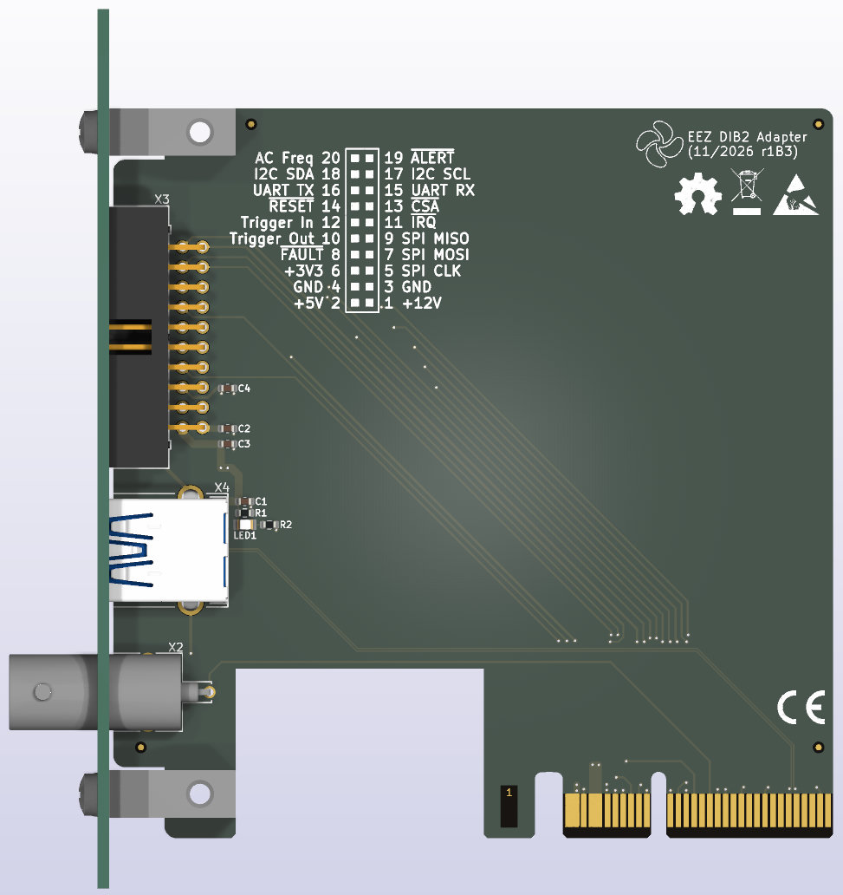

### BB3+ DIB2 adapter

* USB3 A-type socket
* Reference clock BNC connector
* 20-pin IDC for I2C, UART, SPI, Trigger In/Out

### Resources

* [PDF Schematics](../../schematic-diagram/DIB2%20adapter.pdf)
* [Interactive BOM](../../fabrication/bom/DIB2%20adapter/ibom.html)
